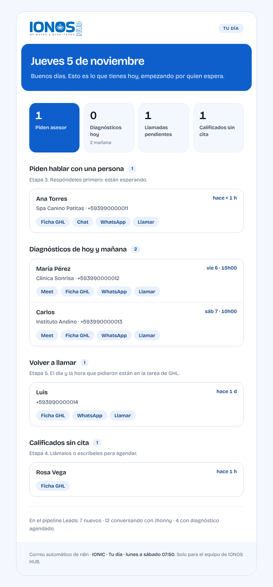
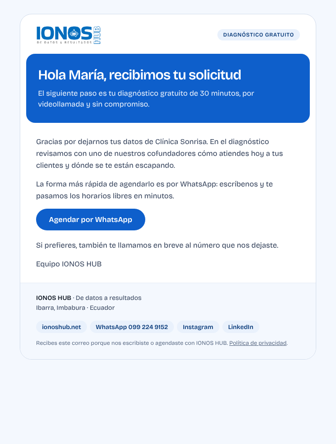

# Correos con la marca de IONOS HUB

Todos los correos que manda n8n en nombre de IONOS HUB salen con la misma plantilla. Arriba va el logo y una píldora de contexto. Debajo, el título en un campo cobalto. Después vienen tarjetas, tablas y botones en píldora, y al final un pie. La letra es Bricolage Grotesque, con Segoe UI, Helvetica o Arial si el cliente de correo no la carga. Los colores son los de `DESIGN.md`.

| Interno (al equipo) | Cliente (leads) |
| --- | --- |
|  |  |

Las capturas usan datos ficticios.

## Cómo funciona

- El subflujo **«Correo · Plantilla de marca»** (n8n, id `B5Rhj7mPIQW8kola`) recibe los datos del correo y devuelve los mismos campos más `html`.
  - No envía nada: cada flujo lo manda con su propio nodo de Gmail.
  - Pasa los adjuntos (`binary`) tal cual.
- `plantilla.js` es la copia de referencia del código de ese subflujo. Si cambias el diseño, cámbialo en los dos lados.
- Patrón en cada flujo: `Datos Correo …` (Code) → `Plantilla de marca` (Execute Workflow, `onError: continuar`) → nodo de Gmail.
  - Mensaje del Gmail: `{{ $json.html || $('Datos Correo …').item.json.html_simple }}`.
  - Si la plantilla fallara, el correo sale igual con un HTML sencillo: un aviso nunca se pierde por el diseño.

## Campos

| Campo | Para qué |
| --- | --- |
| `asunto`, `preheader` | Asunto y texto de vista previa de la bandeja. |
| `etiqueta` | Píldora arriba a la derecha («Tu día», «Urgente», «Cita confirmada»…). |
| `titulo`, `subtitulo` | Van en el campo cobalto. |
| `tono` | `interno`: pie corto con el nombre del flujo. `cliente`: pie con dirección, WhatsApp, redes y política de privacidad. |
| `flujo` | Nombre del flujo, solo en el pie de los internos. |
| `bloques` | Lista de bloques (abajo). También acepta `html` suelto o `texto` plano. |

## Bloques

| `tipo` | Campos | Se ve como |
| --- | --- | --- |
| `texto` | `texto` (saltos de línea → párrafos) o `html` | Párrafos. |
| `seccion` | `titulo`, `contador`, `nota` | Subtítulo, con un contador en píldora. |
| `kpis` | `items: [{ valor, etiqueta, nota, destacado }]` (hasta 4) | Tarjetas de cifra; `destacado` la pinta en cobalto. |
| `tabla` | `columnas`, `filas`, `alinear`, `nota` | Tabla con bordes suaves; una celda puede ser `{ html }`. |
| `lista` | `items: [{ titulo, detalle, detalle_html, meta, enlaces: [{ texto, url }] }]`, `vacio` | Tarjetas por persona con enlaces en píldora (Ficha GHL, Chat, WhatsApp…). |
| `aviso` | `texto` o `html`, `titulo`, `nivel` (`info` / `alerta`) | Caja azul hielo o roja. |
| `nota` | `texto` o `html` | Texto pequeño gris. |
| `boton` | `texto`, `url`, `secundario` | Botón píldora cobalto (o blanco). |
| `codigo` | `texto` | Bloque oscuro para mensajes de error. |
| `separador` | — | Línea. |

El `html` suelto (h2, h3, p, ul, li, table, th, td, a, b) se estiliza solo. La plantilla quita letras ajenas, como Arial, y lleva los azules y grises viejos a la paleta de la marca.

## Flujos que ya la usan

**Internos**
- IONIC · Tu día
- IONIC · Informe semanal de Jhonny
- IONIC · Chequeo diario
- IONIC · Alerta lead sin respuesta
- n8n · Alerta de errores
- GHL IONOS · Vigilante (cupo semanal)
- GHL IONOS · Acciones por Etapa (lead de formulario)
- IONOS · Reporte semanal pauta
- Cuestionarios → PRD (con el PRD adjunto)
- Notificación Nueva Tarea · Plane
- Landing > Correos Leads (aviso interno)
- IONIC: diagnóstico agendado, lead calificado y escalado a persona

**A leads**
- Landing > Correos Leads (correo al lead)
- Cuestionario · Envío y recordatorios
- IONIC: invitación al diagnóstico

Quedan fuera, con intención, los flujos de clientes, que llevan su propia marca: Agendamiento (Daniela Vidal), Send Mails Invoices (Volaire) y Manejo de Errores (Pawau).

## Para un correo nuevo

1. En el flujo, un nodo Code que devuelva `asunto`, `titulo`, `tono`, `bloques`… y un `html_simple` de respaldo.
2. Un nodo Execute Workflow a `B5Rhj7mPIQW8kola` (sin entradas que mapear; con «On error: continue»).
3. El nodo de Gmail con `Message = {{ $json.html || $('Tu nodo Code').item.json.html_simple }}`, tipo HTML y `Sender name = IONOS HUB`.
4. Para revisar el diseño sin enviar nada, ejecuta el flujo con el nodo de Gmail desactivado y abre el `html` que sale de la plantilla.
